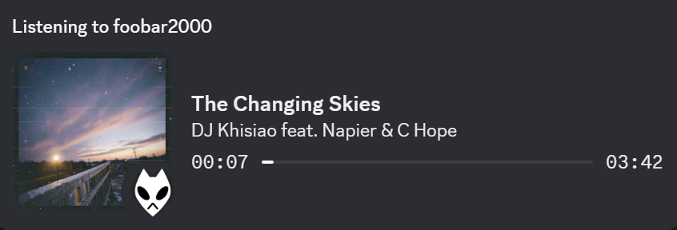
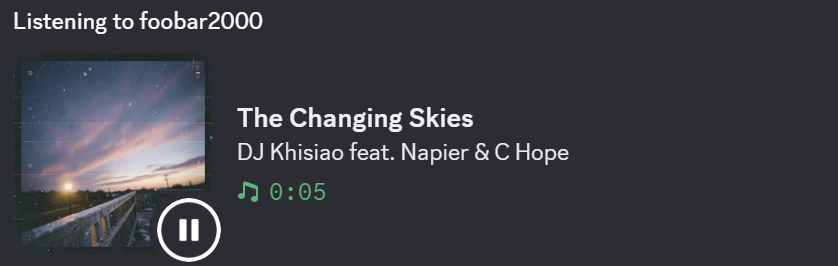

# foobar2000 Discord Rich Presence (reborn)

Show what you're listening to in foobar2000 on your Discord profile, as a Spotify-style "Listening to" card with album art and a live progress bar.

<table>
  <tr>
    <td align="center">
      <br>
      <sub>While playing</sub>
    </td>
    <td align="center">
      <br>
      <sub>While paused</sub>
    </td>
  </tr>
</table>

## Features

- Spotify-style card: title, artist, album cover and a progress bar that follows the song
- Progress bar resets correctly on repeat and updates when you seek
- Album art pulled straight from foobar2000 and hosted on ImgBB (uploaded once per album, then cached)
- Paused state: keeps the cover and title and shows paused
- Status clears when playback stops or foobar2000 is closed
- Reconnects automatically if Discord is closed or restarted
- Small corner icon on the cover (play / paused)

## How it works

```
foobar2000 --(foo_beefweb, local HTTP API)--> foobar_rpc.py --(Discord IPC)--> Discord
                                                   |
                                          cover art --> ImgBB (public URL)
```

foo_beefweb exposes foobar2000's state (track, position, duration, artwork) on `http://localhost:8880`. The script polls it every few seconds, works out the start and end timestamps from the playback position (this is what makes Discord draw a progress bar), and sends them to Discord with [pypresence](https://github.com/qwertyquerty/pypresence). Discord can only show images from a public URL or from your app's uploaded assets, so each cover is uploaded to ImgBB once and the URL is saved in `art_cache.json`.

## Requirements

- Windows with foobar2000 (v2, x64 recommended)
- The [foo_beefweb](https://github.com/hyperblast/beefweb/releases) component
- Discord desktop app (the browser version can't show rich presence)
- Python 3.10 or newer
- A free [ImgBB API key](https://api.imgbb.com/)

## Setup

### 1. Install foo_beefweb

1. Download the `.fb2k-component` file from the foo_beefweb releases page (pick the x64 build for foobar2000 v2).
2. Double-click it, or use File > Preferences > Components > Install..., then restart foobar2000.
3. Check it works: play a song and open `http://localhost:8880/api/player` in your browser. You should see JSON with `"playbackState": "playing"`.
   If it doesn't load, check the port under File > Preferences > Tools > Beefweb Remote Control.

> Only a `.fb2k-component` file installs through double-click. Double-clicking a bare `.dll` does nothing.

If you use another Discord rich presence component in foobar2000, remove it (or move its folder out of `user-components-x64`), otherwise the two will fight over your status.

### 2. Create the Discord application

1. Go to the [Discord Developer Portal](https://discord.com/developers/applications) and click **New Application**.
2. The application name is what appears after "Listening to", so name it something like `foobar2000`.
3. Copy the **Application ID** from the General Information page.
4. Under General Information, upload an **App Icon**. This is the logo shown at the top right of the status (otherwise Discord shows a controller icon).
5. Go to **Rich Presence > Art Assets** and upload the two icons from the [`assets/`](assets/) folder of this repo (or your own square images, 512x512 or larger):
   - `assets/logo.png` as **`logo`**: shown in the corner of the cover while playing
   - `assets/stopped.png` as **`stopped`**: shown in the corner of the cover while paused

   The asset names must be exactly `logo` and `stopped` (lowercase), because the script refers to them by name. If you use your own images, give them those names when you upload. New assets can take a few minutes to become available.

### 3. Get an ImgBB API key

Create a free account at [imgbb.com](https://imgbb.com/) and get a key from [api.imgbb.com](https://api.imgbb.com/).

### 4. Install and configure

```bash
git clone https://github.com/magnusyunus7/foobar2000-discordrpc-reborn.git
cd foobar2000-discordrpc-reborn

python -m venv venv
venv\Scripts\activate
pip install -r requirements.txt
```

Copy `.env.example` to `.env` and fill it in:

```
DISCORD_CLIENT_ID=your_application_id
IMGBB_KEY=your_imgbb_api_key
```

`.env` is ignored by git, so your key stays on your machine.

### 5. Run it

With Discord and foobar2000 open and a song playing:

```bash
python foobar_rpc.py
```

Check your profile in Discord. You should see the card with a progress bar.

## Run on startup (hidden)

1. Press `Win+R`, type `shell:startup` and press Enter.
2. Right-click in the folder > New > Shortcut, and use this as the target (adjust the path to where you cloned the project):

   ```
   "C:\path\to\foobar2000-discordrpc-reborn\venv\Scripts\pythonw.exe" "C:\path\to\foobar2000-discordrpc-reborn\foobar_rpc.py"
   ```

3. Right-click the shortcut > Properties and set **Start in** to the project folder.
4. Double-click the shortcut to test it. There's no window, so check Discord for the status.

`pythonw.exe` runs without a console, so you won't see errors. If something doesn't work, run the script normally with `DEBUG = True` to see what's happening. To stop it, end `pythonw.exe` in Task Manager (Details tab).

The script waits for Discord if it isn't open yet and clears the status when foobar2000 is closed, so the startup order doesn't matter.

## Configuration

Settings at the top of `foobar_rpc.py`:

| Setting | Default | What it does |
| --- | --- | --- |
| `BASE` | `http://localhost:8880/api` | foo_beefweb address. Change it if you changed the port. |
| `POLL` | `3` | Seconds between checks of foobar2000. |
| `DEBUG` | `False` | Print logs to the terminal. Useful when testing. |

The track title and artist come from the `%title%` and `%artist%` tags, so fix messy tags in foobar2000 (right-click tracks > Properties) rather than in the script.

## Limitations

- Discord has no paused state for the progress bar, so while paused the card shows text only and no bar. Discord may add its own elapsed counter there, and I don't know of a way to turn it off.
- Discord limits how often presence can be updated, so seeking can take a few seconds to show up.
- Covers are uploaded to ImgBB and are reachable by anyone with the link. Don't use this if you don't want your album art on a third-party host.
- Tracks without embedded artwork show no cover.
- Discord requires text fields to be at least 2 characters long, so the script pads very short titles or artists with an invisible character.

## Troubleshooting

**Nothing shows up in Discord**
- Use the Discord desktop app, and check Settings > Activity Privacy > "Share my detected activities".
- Make sure only one copy of the script is running (check Task Manager for `python.exe` / `pythonw.exe`). Duplicates overwrite each other.
- Open `http://localhost:8880/api/player` and confirm it returns JSON with `"playing"`.
- Set `DEBUG = True` and run from a terminal.

**`Missing DISCORD_CLIENT_ID or IMGBB_KEY in .env`**
The `.env` file is missing, in the wrong folder (it must sit next to `foobar_rpc.py`), or a value is empty.

**Cover shows but the small corner icon doesn't**
Check that the Art Assets are named exactly `play` and `paused` on the same application whose ID is in your `.env`, that they're at least 512x512, and give Discord a few minutes. Restart the script after changing anything.

**No cover art**
Check your ImgBB key and run with `DEBUG = True` to see upload errors. Failed covers aren't retried until you restart the script.

**Changes to the code don't take effect**
The old process is still running. Stop it with `Ctrl+C`, or end `pythonw.exe` in Task Manager, then start it again. Restarting Discord or foobar2000 doesn't reload the script.

**New cover still shows the old image**
Covers are cached by artist and album in `art_cache.json`. Delete the entry (or the whole file) to re-upload.

## Project files

| File | Purpose |
| --- | --- |
| `foobar_rpc.py` | The script |
| `requirements.txt` | Python dependencies (`pypresence`, `requests`, `python-dotenv`) |
| `.env.example` | Template for your `.env` |
| `art_cache.json` | Created on first run: cover URLs already uploaded (git-ignored) |

## Credits

- [foo_beefweb](https://github.com/hyperblast/beefweb) for the foobar2000 HTTP API
- [pypresence](https://github.com/qwertyquerty/pypresence) for the Discord rich presence client
- [ImgBB](https://imgbb.com/) for image hosting